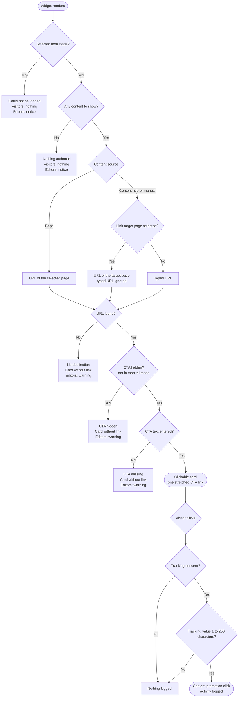

# Content promotion widget: call to action behavior

The promotion card links only when it has a destination and a call to action (CTA) that is visible.
This document describes how the *Content promotion* widget decides where the link goes, when the card is
clickable, what editors and visitors see, and when a click is logged as an activity.

Beyond documenting the widget itself, this file demonstrates how developers can capture behavior during implementation in a structured way which they can provide stakeholders as a part of project documentation and usage guides.

The widget lives in `src/TrainingGuides.Web/Features/ContentPromotion/`.

## Summary

- The whole card is one link, and the link exists only with a destination URL and CTA text that is not
  hidden. See [Decision flow](#decision-flow).
- A selected page always wins over a typed URL, even when that page cannot be loaded. See
  [Destination](#destination).
- A card that cannot be clicked still renders for visitors. Only editors see a warning, under the card,
  in Page Builder edit mode. See [Outcomes](#outcomes).
- A click is logged only with tracking consent and a valid tracking value. See
  [Click tracking](#click-tracking).
- The widget never invents a fallback CTA label. See [Decision: no fallback label](#decision-no-fallback-label).

## Decision flow

The widget checks its state in this order. The first check that fails decides what the editor and the
visitor see.

## Destination

| Content source | Destination | Ignored even when stored |
| --- | --- | --- |
| Page | The selected page links to itself. | Link target page and typed URL |
| Content hub item | The link target page, or a typed URL when no target page is selected. | Typed URL once a target page is selected |
| Manual content | The link target page, or a typed URL when no target page is selected. | Typed URL once a target page is selected |

- **Hidden fields keep their values.** A visibility condition removes a field from the form but does not
  clear what was saved. `ContentPromotionService.ResolveLink` therefore applies the same rule as the form:
  a typed URL counts only where the form shows it.
- **Form rule.** `LinkUrl` carries `VisibleIfNotEqualTo` on the content source and `VisibleIfEmpty` on
  `LinkTargetPage`. The two conditions combine with AND.
- **Unloadable target page.** When a selected target page cannot be loaded, the card has no destination.
  The widget does not fall back to a typed URL the editor can no longer see.
- **Page URLs.** `TrainingGuidesWebPageUrlRetriever` returns an empty URL instead of throwing for a page it
  cannot resolve, so a wrong identifier shows up as a missing destination, not as an error.

## Outcomes

Only the first two states hide the widget from visitors. The other three are warnings: the card renders
without a link, and the notice appears only in Page Builder edit mode.

| State (`MisconfigurationReason`) | Visitors see | Editors see in edit mode |
| --- | --- | --- |
| `ItemCouldNotBeLoaded` | Nothing | Notice that the selected item could not be loaded |
| `NothingAuthored` | Nothing | Notice to add content or select an item |
| `NoDestination` | Card without link | *This promotion has no destination. Choose a link target page or type in a link URL.* |
| `CallToActionHidden` | Card without link | *The call to action is hidden, so visitors cannot click this promotion.* |
| `CallToActionMissing` | Card without link | *This promotion has no call to action text, so visitors cannot click it. Type in a call to action.* |
| `None` | Card with CTA button; the whole card follows the link | The same card, no notice |

- **CTA text source.** The CTA text comes only from the widget's own property. No content type supplies a
  CTA text to inherit.
- **Hide elements in manual mode.** `ContentPromotionWidgetProperties.IsElementHidden` ignores a stored
  *Hide elements* value in manual mode, so the `CallToActionHidden` state cannot occur there.
- **Published pages** open read-only, so editors see the warnings after creating a new version of the page.

## Click tracking

A clickable card renders exactly one anchor: the CTA button, stretched over the card with an overlay. A
click anywhere on the card, including the title and description, follows the link. One anchor gives the
card one accessible name and one place to attach click tracking, so the card contains no other links or
buttons.

1. **The visitor clicks the card.** A left click, a Ctrl+click, and a middle click each send one tracking
   request. A right click sends nothing.
2. **The browser sends a beacon.** `wwwroot/assets/js/ContentPromotionActivityLogger.js` posts the
   tracking value with `navigator.sendBeacon()` to the URL in the anchor's `data-tracking-url` attribute.
   When the browser refuses the beacon, the script falls back to a `fetch` request with `keepalive`.
3. **The server checks consent.** Without tracking consent, `ContentPromotionActivityController` logs
   nothing and still returns success, so a normal visit without consent produces no console error.
4. **The server checks the tracking value.** An empty value, or a value longer than the 250-character
   activity column, is not logged. A long value is refused rather than shortened, because reports group
   by it.
5. **The activity is logged.** The `contentpromotionclick` custom activity is recorded with the tracking
   value. The activity title is shortened to fit its column.

When the editor turns on *Open in new tab*, the anchor gets `target="_blank"` with
`rel="noopener noreferrer"`.

## Decision: no fallback label

**Context:** A destination exists, but the card has no CTA text, or the CTA is hidden.

**Options:** Render a localized fallback label so the card stays clickable, or keep the card unclickable
and show an editor-only warning.

**Decision:** Show an editor-only warning.

**Reason:** The editor supplies copy that matches the campaign. A generic fallback label changes the
intended message.

## Code

| File | Role |
| --- | --- |
| `Services/ContentPromotionService.cs` | `ResolveLink` picks the destination. |
| `Widgets/ContentPromotion/ContentPromotionWidgetProperties.cs` | Visibility conditions for the link fields, `IsElementHidden`. |
| `Widgets/ContentPromotion/ContentPromotionWidgetViewModel.cs` | `MisconfigurationReason` and the order of the checks. |
| `Widgets/ContentPromotion/ContentPromotionWidget.cshtml` | The stretched CTA anchor and the edit-mode notices. |
| `Widgets/ContentPromotion/ContentPromotionActivityController.cs` | Consent and tracking value checks, activity logging. |
